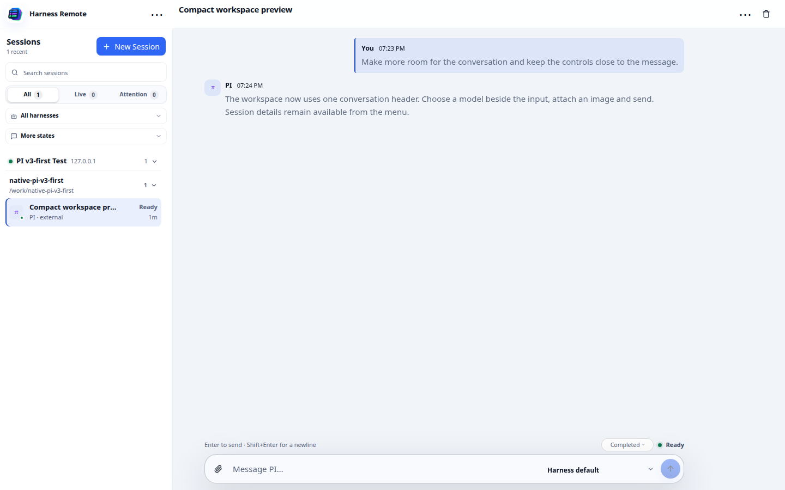

# Compact workspace — 3.5.0-local.3

Candidate branch: `ui/compact-session-layout`, based on `fix/long-resume-early-stop` (local.2).
The native resume, cancellation and permission-denial fixes remain included.

Global navigation now sits over the Session rail. Its disclosure contains machine management,
settings, refresh, the command palette and workspace context. The conversation has one title row;
its details disclosure retains origin, directory, native id and statistics. Native deletion keeps
its existing confirmation flow. Menus close on outside pointer input, focus leaving or Escape.

The composer starts at one line and grows to the existing bounded maximum. Attachment and
Send/Stop buttons live inside its border. Hints and outcome/state appear above it. The model and
optional harness selectors sit inside the composer on desktop. On a narrow phone they share the
small status line above it, keeping the text field at full width. A one-option harness selector is
hidden. The model list opens upwards. Native Send, Stop, image paste/selection, queue and steering
handlers are unchanged; no new history reads or refresh loops were introduced.

## Previews

These are screenshots of the real built UI with synthetic data and a fake gateway, not real model
responses or user Sessions.

[Phone preview](previews/compact-phone.png)

## Validation

Full web suite, including desktop tests, passed. Type checking and production build passed.
The existing browser smoke selectors were updated to the composer-specific control classes.
An isolated headless Chromium check exercised the actual production build at these sizes:

| Viewport | Session header | Empty composer |
| --- | ---: | ---: |
| Desktop 1440 × 900 | 52 px | 54 px |
| Laptop 1024 × 768 | 52 px | 54 px |
| Phone 390 × 844 | 57 px | 53 px |
| Phone landscape 844 × 390 | 57 px | 53 px |

The check verified button bounds, absence of horizontal page overflow, model-list bounds, menu
opening/Escape dismissal and textarea growth with multiline content. It reported zero JavaScript
exceptions. An additional layout-only simulation exposed multiple harness controls on the phone;
it is not proof of a real cross-harness handoff. Browser tests used only synthetic Sessions, a new
browser profile and OS-assigned loopback ports. Test processes were bounded and removed afterwards.

## Next isolated lab check

Build the matching local.3 gateway/web artifacts from this branch. Update only the existing test
Compose project, keeping its own volumes, credentials, verified resource limits and owned port
mappings. Check the matching source commit/version and SHA256SUMS. The working deployment and Home
Assistant remain outside this change.

On a physical phone, verify the on-screen keyboard, paste/attach an image, send, Stop and continued
input while a turn runs. Check model selection, Session details, Machines/Settings and switching
Sessions. Repeat the native long-resume/early-Stop/sandbox gates in LOCAL_2_RETEST.md; UI preview
checks do not replace those outstanding backend acceptance cases. No HA deployment is validated.
