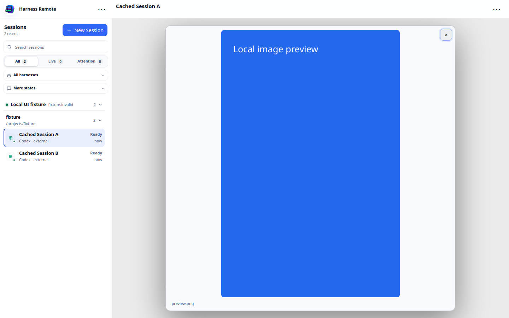
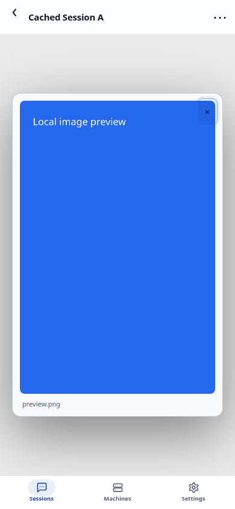

# local.7: image preview inside the chat

Branch: `fix/chat-image-preview`. Record the exact clean commit for `3.5.0-local.7` before building.
This candidate includes local.6 and the separate native endurance diagnostic. Image viewing does
not change bridge runtime behavior, native policy, history budgets, queue, Stop or resource limits.
The existing local.6 release archives are preserved unchanged.

## Behavior and previews

The opaque image overlay covers the transcript and composer only. Its portal targets the chat's
own positioned, isolated surface, outside the transcript scroll box. The Session header, global
navigation, rail and mobile navigation remain accessible. The preview is non-modal: Tab can reach
surrounding controls and the global menu remains usable. A Session switch removes the old preview.
Focusing a covered chat control closes the preview so that control becomes visible again.

Escape from the chat, the close button and background click dismiss it. Focus returns to the
thumbnail unless the user has moved into navigation. Outside menus retain their Escape key.
Normal CSS layout keeps the image within the chat on resize/rotation, without viewport polling.




## Completed local validation

- Full serial bridge: 831/831 with a separate empty HOME/CODEX_HOME.
- Full web suite, including desktop: passed. The initial sandboxed run could not bind local test
  sockets; the full loopback-enabled run passed. TypeScript and production build passed, with the
  existing main-chunk size advisory.
- Actual production image smoke: six cases, generated 1200x1800 PNG. Desktop 1440x900 light/dark
  and 1024x768; touch 390x844 light/dark and 844x390. Chat-local portal and opaque background,
  panel/image bounds, header/rail hit testing, global menu, real Tab to navigation, Escape and focus
  restoration, close button, background mousedown, rotation and Session switching passed.
- Cached geometry stress after introducing the local surface: 12/12, 851 visible frame samples,
  zero outside the unchanged 1px tail tolerance; all reader-preservation samples remained at 0.

These browser probes use fresh incognito contexts and synthetic transport in the actual built app,
without credentials or model calls. Physical phone keyboard/device behavior remains unverified.
Logs: `/tmp/local7-{build,web-tests-network,bridge-tests}.log`. JSON/screenshots:
`/tmp/local7-image-preview-final2/` and `/tmp/local7-workspace/`.

## Isolated Mac lab retest

Follow [LOCAL_6_RETEST.md](LOCAL_6_RETEST.md) with the exact local.7 commit/version. Keep existing
15431/15432 ports, HARNESS_LAB_* environment, machine identity, login, native home, project volumes,
CORS and cgroup limits. Retain the current local.6 images/Compose for rollback. Recreate only the
lab gateway/web with the matching pair; verify checksums, both authenticated health versions, web
manifest, native index, login, and unchanged working 4097/5300 services. Do not migrate user data.

For the new image probe, select a dedicated private CDP endpoint on a verified free port. It does
not launch a browser or modify the gateway. From the clean source root:

```sh
HARNESS_UI_CDP_URL="${LAB_PRIVATE_CDP_URL:?Set the separate test browser endpoint}" HARNESS_UI_APP_URL=http://localhost:15431/ HARNESS_UI_ARTIFACTS_DIR="${LAB_IMAGE_ARTIFACTS_DIR:?Set a fresh absolute host log directory}" node --v8-pool-size=1 --max-old-space-size=128 web/scripts/chat-image-preview-smoke.mjs
```

Repeat the cached geometry smoke and manually view a real test attachment. Confirm headers and
Sessions remain usable with it open and that closing restores the underlying reader's position.
The inherited native endurance check is [LOCAL_6_ENDURANCE.md](LOCAL_6_ENDURANCE.md); its script now
derives health identity from the staged version and can run local.7. Keep 1GiB/no-swap/1CPU/128PID,
collect process snapshots/cgroup events, and do not increase limits to obtain a pass.

The user's final local.6 lab report passed native-to-gateway 40k and the four-hour offline soak.
Mac sandbox availability, its earlier live PID-limit event, the physical phone and other outstanding
integration gates remain separate. A local.6 pass is not an exact-image local.7 pass. This UI change
does not approve tools on that Mac host or authorize working/HA deployment. Roll back only the lab's
retained image/configuration pair, preserving volumes; never use `down -v` or a global Docker prune.
